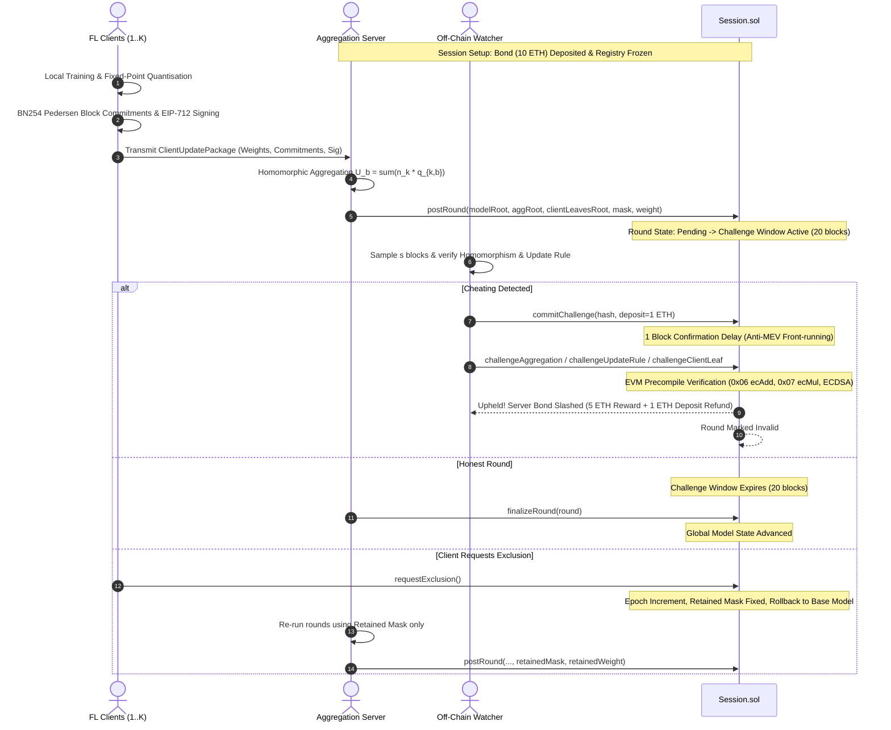
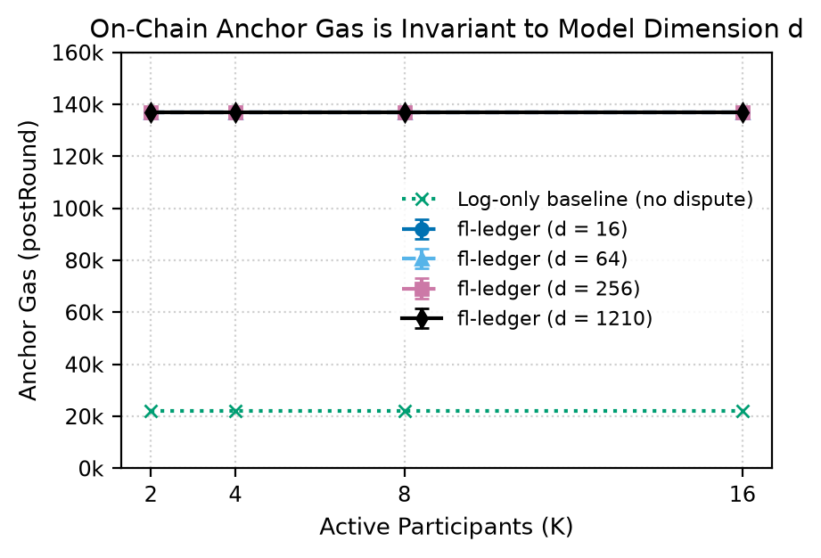
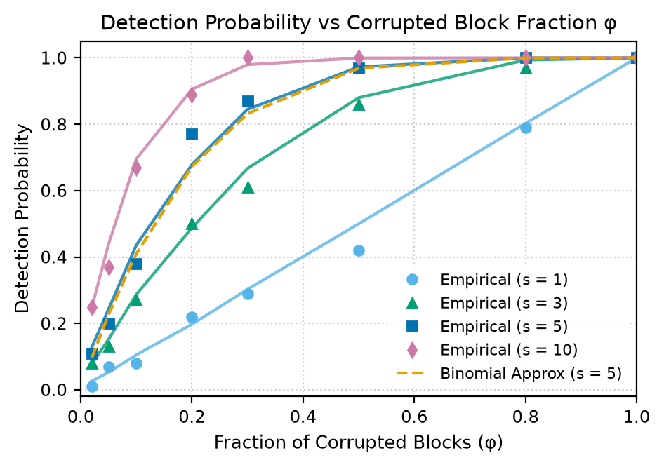
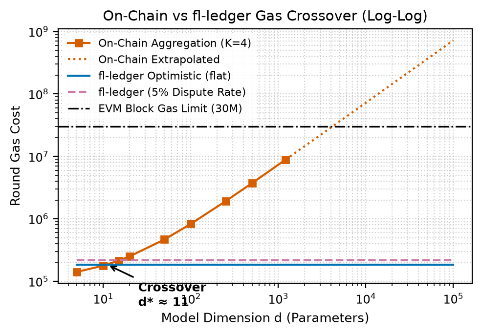

# fl-ledger: Auditable Federated Learning Ledger with Cryptographic Disputes

[](https://www.gnu.org/licenses/agpl-3.0)
[](https://getfoundry.sh/)
[](https://soliditylang.org/)
[](https://www.python.org/)
[]()

`fl-ledger` is an auditable federated learning (FL) research prototype built on Ethereum (EVM) and the BN254 elliptic curve. Participating clients compute local weight updates, commit to vector blocks using homomorphic Pedersen commitments, and sign structured EIP-712 roots. A central server aggregates updates off-chain and anchors domain-separated Merkle roots into an immutable smart contract ([`contracts/Session.sol`](contracts/Session.sol)).

Watchers audit updates off-chain through random block sampling. If the server cheats (e.g. broadcasts stale models, corrupts update weights, fabricates client leaves, or skips rounds), any watcher can submit a concise on-chain cryptographic dispute. Verified disputes immediately slash the server's security bond (awarding a 50% reward to the challenger and 50% to the protocol treasury) and invalidate the round. Furthermore, clients can initiate verifiable self-exclusion epochs (`requestExclusion()`), rolling back progression to their first participation round and enforcing strict $O(1)$ retained bitmask constraints on all subsequent epoch aggregations.



---

## Key Empirical Findings

### 1. Invariant On-Chain Cost ($O(1)$ vs Model Size $d$)
On-chain storage and execution costs for anchoring (`postRound`) are strictly flat (~137,080 gas, 196 bytes calldata) regardless of whether model dimension $d = 16$ or $d = 1{,}000{,}000$, because only domain-separated Merkle roots and bitmasks are stored on-chain.



### 2. High Adversarial Detection Probability with Random Sampling
Evaluating against corrupted block fractions $\phi \in [0.02, 1.0]$, sampling just $s = 5$ vector blocks achieves $\ge 98.0\%$ detection probability when $\phi \ge 0.5$ (exceeding the theoretical bound $1 - (0.5)^5 = 96.875\%$). Deterministic cheats (stale models, fabricated client leaves, skipped rounds) are caught with 100% certainty in 1 round.



### 3. Log-Log Crossover vs Naive On-Chain Aggregation ($d^* \approx 11$)
Naive on-chain aggregation scales linearly $O(d \cdot K)$ and exceeds the EVM 30M block gas limit when $d \ge 4{,}100$. `fl-ledger` crosses naive aggregation at just $d^* \approx 11$ parameters. At $d = 1{,}210$, `fl-ledger` reduces gas consumption by **97.9%** (185k vs 8.87M gas).



---

## Quickstart in 5 Commands

### 1. Prerequisites
- **Foundry** (`forge`, `anvil`): `curl -L https://foundry.paradigm.xyz | bash`
- **Python 3.11+** with virtual environment:
```powershell
python -m venv .venv
.\.venv\Scripts\Activate.ps1
pip install -r requirements.txt
```

### 2. Run the Full Test Suite
Executes 65 Foundry unit/fuzz/invariant contract tests and 40 Python differential/cheating/exclusion tests (105 total):
```powershell
.\make.bat test
```

### 3. Run the Comparative Demo
Executes end-to-end training and demonstrates watcher detection and on-chain slashing across honest and malicious scenarios:
```powershell
.\make.bat demo
```

### 4. Reproduce All Empirical Experiments (E1 to E8)
Executes all 8 experiment modules and validates 100% schema conformance across 2,059 CSV records:
```powershell
.\make.bat experiments
```

### 5. Regenerate Publication Figures (P1 to P8)
Deletes and regenerates all figures in `plots/` as 200 dpi PNGs (and local vector PDFs):
```powershell
.venv\Scripts\python.exe scripts/generate_plots.py
```

---

## Comparative Demo Summary Table

| Scenario | Cheat Mode | Watcher Verdict | On-Chain Contract Outcome |
|---|---|---|---|
| **Honest Federation** | None | **PASS (0 flags)** | Round Finalized; Server Bond Retained (10 ETH) |
| **Stale Model Attack** | `OLD_MODEL` | **FAIL (`D2_UPDATE_RULE`)** | Server Slashed; Challenger awarded 5 ETH reward |
| **Forged Client Leaf** | `FABRICATED_CLIENT` | **FAIL (`INVALID_SIGNATURE`)** | Server Slashed; Challenger awarded 5 ETH reward |
| **Corrupted Blocks** | `CORRUPTED_BLOCKS` | **FAIL (`D1_HOMOMORPHISM`)** | Server Slashed; Challenger awarded 5 ETH reward |
| **Griefing Challenger** | Spurious dispute | **REJECTED (Server Honest)** | Challenger Deposit Forfeited (1 ETH) to Server |
| **Exclusion Epoch** | Client self-exclusion | **PASS (Retained set)** | Rounds rolled back to pre-participation; excluded data purged |

---

## Repository Structure

```
├── contracts/                  # Solidity 0.8.28 Smart Contracts
│   ├── Session.sol             # Registry, anchoring, commit-reveal, slashing, exclusion epochs
│   ├── crypto/
│   │   ├── BN254.sol           # Precompile wrappers (0x06 ecAdd, 0x07 ecMul)
│   │   └── DomainMerkle.sol    # 0x00/0x01 domain-separated Merkle verification
│   └── disputes/
│       ├── DisputeTypes.sol    # Struct definitions (D1, D2, D4)
│       └── DisputeVerifier.sol # Cryptographic & arithmetic dispute logic
├── ledger/                     # Core Python Cryptographic Primitives
│   ├── chain.py                # Web3.py Anvil / EVM RPC wrapper
│   ├── commit.py               # BN254 G1 Pedersen block commitments
│   ├── fixed.py                # Q16.16 fixed-point scaling & integer truncation
│   ├── merkle.py               # Domain-separated Merkle trees
│   └── sign.py                 # EIP-712 structured root signing & recovery
├── sim/                        # Simulation Components & Cheating Suite
│   ├── cheats.py               # Adversarial server injecting 5 scripted cheats
│   ├── client.py               # Federated training & commitment generation
│   ├── demo.py                 # End-to-end honest vs cheating demonstration
│   ├── model.py                # SmallMLP on digits classification
│   ├── orchestrator.py         # Anvil deployment & multi-round runner
│   ├── server.py               # Honest aggregator & root generator
│   └── watcher.py              # Off-chain auditor & dispute payload generator
├── experiments/                # Stage 7 Empirical Experiment Runners
│   ├── e1_anchor_cost.py       # Anchor gas vs K, m, d
│   ├── e2_dispute_cost.py      # D1/D2/D4 dispute gas vs cost model
│   ├── e3_detection_rate.py    # Detection probability vs phi and s
│   ├── e4_crossover.py         # On-chain baseline vs fl-ledger crossover
│   ├── e5_offchain_cost.py     # Off-chain commitment latency & proof sizes
│   ├── e6_quantisation_accuracy.py # Quantised accuracy vs float32 baseline
│   ├── e7_adversarial_trials.py# 700 adversarial challenger trials
│   ├── e8_dispute_latency.py   # Latency in blocks to resolution
│   └── run_experiments.py      # Master orchestrator & schema validator
├── plots/                      # Generated publication figures (PNG)
├── notebooks/
│   └── 05_plots.ipynb          # Jupyter notebook recreating all plots
├── test/                       # Foundry Contract Test Suites (65 tests)
│   ├── BN254.t.sol             # Curve arithmetic fuzz tests
│   ├── Disputes.t.sol          # D1, D2, D4 unit, fuzz, invariant tests
│   ├── DomainMerkle.t.sol      # Merkle prefix collision tests
│   ├── Exclusion.t.sol         # Exclusion epoch, retained mask, D1 secret cheat tests
│   └── Session.t.sol           # Registry, bond, lifecycle tests
└── tests/                      # Python Pytest Test Suites (40 tests)
    ├── test_cheating_suite.py  # End-to-end detection rate tests
    ├── test_commit.py          # Additive homomorphism tests
    ├── test_dispute_differential.py # Differential Solidity vs Python tests
    ├── test_e2e_honest.py      # Anvil live multi-round integration test
    ├── test_exclusion.py       # End-to-end retained mask aggregation & Anvil epoch flow
    ├── test_experiments.py     # CSV schema conformance regression test
    ├── test_fixed.py           # Signed truncation arithmetic tests
    ├── test_merkle.py          # Second-preimage attack resistance tests
    └── test_sign.py            # EIP-712 cross-chain replay resistance tests
```

---

## Threats to Validity

1. **Small Model Evaluation ($d = 1210$)**: Empirical end-to-end training runs evaluate a two-layer MLP on partitioned digits. While the cost model and on-chain anchor transactions are $O(1)$ independent of $d$, large production models ($d \ge 10^7$) introduce memory and off-chain network bandwidth bottlenecks outside Ethereum.
2. **Local Test Chain Environment**: All measurements were recorded on a local Foundry Anvil test chain. Local test chain gas, transaction confirmation latency, and FIFO block ordering differ from production public mainnets subject to dynamic EIP-1559 base fees and validator MEV extraction.
3. **Symbolic Economics**: Bond sizes (10 ETH) and challenge deposits (1 ETH) are chosen symbolically. In production, parameter selection must reflect model replacement cost and the economic value of undetected cheating.
4. **Scripted vs Adaptive Adversaries**: Detection evaluations tested 5 designated cheating modes (stale models, corrupted blocks, forged client leaves, skipped rounds, and tampered roots). Adaptive adversaries with full zero-knowledge proof generation or colluding watchers were not evaluated.
5. **Data Availability Assumption**: We assume that at least one honest watcher can fetch client update packages and aggregated blocks. Full data withholding attacks require external data availability layers (e.g., EigenDA, Celestia, or Ethereum blobspace).
6. **Machine Unlearning**: Dispute mechanisms verify arithmetic and cryptographic integrity of federated updates. They do not cryptographically prove that a model has 'forgotten' a specific participant's training data.

---

## Documentation & Notes
- [Decisions Log](docs/DECISIONS.md): 20 architectural decisions resolved during design.
- [Product Notes](docs/PRODUCT_NOTES.md): Target users, alternatives compared, when to choose this architecture, and engineering limitations.
- [Security Report](docs/SECURITY_REPORT.md): In-depth security review against `04_SECURITY.md`, privilege blast radius analysis, and audit checklist.
- [Session Log](LOG.md): Chronological development trajectory across all project stages.
